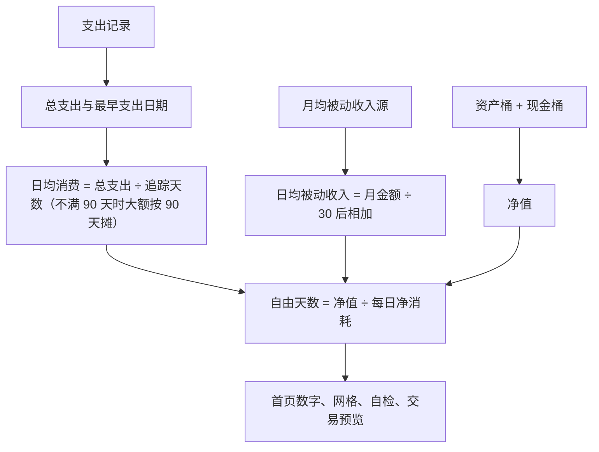

# FreeGrid 代码阅读地图

这份指南面向想看懂 App、暂时不打算从零写代码的人。先掌握一条完整路径：**页面收集输入 → 计算预览 → 保存记录 → 页面自动更新**。遇到问题时，沿这条路径判断卡在哪一步。

## 1. 文件夹就是职责边界

```text
FreeGrid/
├── App/          启动、四个 Tab、平台差异和启动失败页
├── Models/       哪些事实会保存到设备
├── Logic/        根据事实计算自由天数、预览、自检
├── Data/         打开数据库、保存/撤销、导入/导出
├── Features/     按功能组织的页面和弹窗
│   ├── Dashboard/    首页、主数字、自由网格、流星装饰
│   ├── Assets/       双桶、调拨、被动收入、导入确认
│   ├── Transactions/ 支出、收入、修改记录三个表单；日期行共用 TransactionDateRow
│   ├── Simulation/   模拟决策及格子动画
│   ├── History/      历史记录和月度汇总
│   └── Settings/     设置、数据管理（导出/导入/清空）和财富自由自检
└── UI/           共用颜色、卡片、按钮、金额格式、预览和错误提示
```

`FreeGridTests/` 用具体输入验证计算和保存结果；`FreeGridUITests/` 模拟用户点击、输入、切换页面。`Assets.xcassets/` 放图标等素材，与显示钱的 Assets 页面不是同一回事。

## 2. 先读这六个入口

| 阅读顺序 | 文件 | 只需先回答的问题 |
|---|---|---|
| 1 | [ContentView](FreeGrid/App/ContentView.swift) | App 有哪四个页面？点击首页引导后怎样切到资产页？ |
| 2 | [LedgerModels](FreeGrid/Models/LedgerModels.swift) | 一笔支出究竟保存哪些字段？现金存在哪里？ |
| 3 | [AddExpenseSheet](FreeGrid/Features/Transactions/AddExpenseSheet.swift) | 用户填写哪些东西？保存按钮什么时候可用？ |
| 4 | [TransactionImpact](FreeGrid/Logic/TransactionImpact.swift) | 如果记下这笔，净值、日均消费和自由天数会怎样变化？ |
| 5 | [LedgerStore](FreeGrid/Data/LedgerStore.swift) | 什么时候真正写入？失败怎么办？撤销怎样还原？ |
| 6 | [DashboardView](FreeGrid/Features/Dashboard/DashboardView.swift) | 保存后，新数字如何出现在首页？ |

可以暂时跳过动画的数学、JSON 兼容细节和 macOS 条件分支。它们有独立文件，等需要改对应功能时再读。

## 3. 保存的是事实，其他数字由事实算出

[LedgerModels](FreeGrid/Models/LedgerModels.swift) 包含七种持久化模型（前五种从 1.5 起，`AssetItem` 和 `Loan` 是 Pro 新加的；`Expense` 在 Pro 里多了两个可选含义的字段）：

| 类型 | 意义 | 典型字段 |
|---|---|---|
| `Expense` | 一笔支出 | `amount` 金额、`category` 分类、`date` 消费日期、`note` 备注 |
| `Income` | 一笔收入 | `amount` 金额、`source` 来源、`date` 日期 |
| `UserAssets` | 资产和现金的当前余额，约定只有一行 | `lockedAssets` 资产、`cash` 现金 |
| `PassiveSource` | 持续的月均被动收入源 | `monthlyAmount` 折合的每月金额；`intervalMonths` 几个月到账一次（只用来填写和显示，备份里每月时不写） |
| `Device` | 旧账里的持有物/设备 | 价格、购买日期、卖出信息；目前通过备份保留 |
| `AssetItem` | Pro：资产桶里的一项（房、车、定期…） | `name` 名称（1–20 字）、`amount` 金额、`sortOrder` 顺序、`countsInFreedom` 自由天数开关 |
| `Loan` | 固定支出（房租、保险、订阅，免费）和贷款（房贷、车贷，Pro） | `monthlyAmount` 每期金额、`dueDay` 几号、`isOngoing` 是不是没有尽头的固定支出、`intervalMonths` 隔几个月一次（贷款恒为 1）、`periodsAtStart` 贷款起算时的期数（固定支出是 0）、`startDate` 起算日（固定支出是「下次付款日」的前一天，可能在未来）、`processedThrough` 自动扣到哪天、`settledDates` 从别处付的到期日 |

`Expense` 的 `loanID` 指向 `Loan` 时，这笔是到期自动扣的房租或月供；`countsInBurn` 为 false 的支出扣过现金，但不算进日均消费（自动扣的，和用户确认过「以前记的」）。

`id` 是记录的身份证；`date` 是这笔钱发生的日期；`createdAt` 是创建记录的时间。补录去年消费时，后两者不同。

`FinancialSnapshot` 是**当前计算结果**：总支出、追踪天数、日均消费、净值、被动收入与自由状态。它没有 `@Model`，不会再保存一份数据库，也没有需要手动刷新的缓存。

正常情况下的计算路径：



[FreedomMath](FreeGrid/Logic/FreedomMath.swift) 负责这些规则。追踪天数从最早一笔支出算到今天，包含今天；只有收入或资产时，还没有消费基线。

日均消费由 [DailyBurn](FreeGrid/Logic/DailyBurn.swift) 的 `FreedomMath.burnEstimate` 估：总支出 ÷ 追踪天数，只多一条——记账不满 90 天时，单笔大额支出按 90 天摊（一笔算大额：达到「有花销的日子每天合计的中位数」的 30 倍；当普通支出记的房租每笔都按 90 天摊，日均平滑地涨到真实值）。记满 90 天以后和原公式一分不差。首页、记一笔的预览、趋势的每个周点、History 的折算天数都调它，口径只有一个。界面上写的「日均消费」是 `FinancialSnapshot.dailyCost`：这个日常日均再加上固定支出和月供折成的每天（`dailyFixed`）；自由天数的推演只用日常日均，固定支出按日历在到期日另扣，不算两遍。

自由状态有四种，代码用 `FreedomState` 区分：

- `insufficientData`：还没有支出，无法估计日均消费。
- `finite(days:)`：可以算出具体天数；净值小于零时按零天显示。
- `covered`：已有有效消费数据，被动收入足以覆盖日均消费。
- `invalidData`：已有数据无法正常计算，例如金额不是有限数字或日均消费不大于零。

因此 `—` 和 `∞` 意思不同，不能互相替代。旧账里的退款、零元记录仍然保留；若净支出导致日均无法计算，应显示无法计算的状态。

首页趋势的实现放在 [FreedomHistory](FreeGrid/Logic/FreedomHistory.swift)，仍是 `FreedomMath` 的一部分。它与摘要共用自然日口径，`now` 可由测试传入；中午录入的最早支出也不会少算一天。每笔交易只归入一次周区间，再用累计值计算最多 13 个周点，避免大账本被反复扫描。

趋势点保存 `FreedomState`。只有有限天数的起终点才相减；“已覆盖”不会再变成 1825 天。当区间内含覆盖、数据不足或异常状态时，界面显示真实状态、不画数值折线。趋势仍按**当前**被动收入与账目反推，是估算，不是历史资产快照。

## 4. 跟着一笔“午餐 30 元”走完整条路

1. [AddExpenseSheet](FreeGrid/Features/Transactions/AddExpenseSheet.swift) 的 `@State amount` 保存输入框里的文字。此时还没有记账。
2. `Double(amount)` 尝试把文字转成金额；`isAmountValid` 检查金额、日期、备注长度和结果余额。
3. 页面用现有记录建立 `FinancialSnapshot`，再交给 `TransactionImpact` 算“如果保存”的结果。
4. [TransactionImpactView](FreeGrid/UI/TransactionImpactView.swift) 把结果画出来。支出表单、收入表单、模拟页共用它。
5. 点击保存后，`save()` 创建一条 `Expense`，调用 `LedgerStore.add(.expense(expense), in: modelContext)`。
6. `LedgerStore` 插入支出、现金减去 30、更新最早支出日期，检查最终双桶余额后明确调用数据库保存。失败会还原本次操作，表单显示错误并保留输入。若数据库入口已有其他未保存修改，则先拒绝新操作，避免一起回滚它们。
7. 成功后才调用 `onSaved` 通知首页，再 `dismiss()` 关闭表单。
8. 首页的 `@Query` 读到新记录，重新生成摘要并绘制页面；撤销按钮调用 `LedgerStore.undo` 删除记录并反向调整现金。

假设目前现金 1000 元、今天已记支出 100 元、无其他资产或被动收入：再记午餐 30 元后，现金是 970 元，日均消费是 130 元，自由天数约 7.46 天。预览和真正保存之后用同一套计算规则。

**补录会改变统计区间。** 如果今天只记录了 100 元，补录九天前的一笔 1 元，日均从 100 变成 101 ÷ 10 = 10.1 元。即使现金减少，自由天数估计也可能增加。这反映的是统计区间变了；预览会提示这个原因。

搜索沿另一条只读路径工作：`HistorySearchDataSource` 只在 body 中观察记录身份与地区设置；`HistorySearchModelObserver` 在 body 之外用 `withObservationTracking` 跟踪真正参与搜索和显示的字段，焦点变化不会重新提取快照。记录集合或字段变化时，在主 actor 上通过 `LedgerTransaction.searchRecord` 提取可发送的值类型快照。后台 `HistorySearch.Index` 归并两个有序数组（字段通知先于查询重排时，仅对乱序快照补排），为变化的记录准备小写文本、金额格式、月份及行里显示的金额和日期；未变化的记录复用上一次结果。`HistoryTransactionRow` 是独立的固定行视图，搜索行内容不变时跳过重算；结果行直接使用只读快照显示；当前数据库模型只保留在主 actor 的查找表中，点击编辑或撤销时才按稳定 ID 取出。

`HistorySearchBar` 独立观察实时输入；每次打开搜索只消费一次自动聚焦请求，列表滚回输入框时不再次弹键盘。`HistorySearchState` 对文字输入防抖 180ms，在后台用已准备好的字段匹配、分组和汇总。新查询、账本更新和取消都会撤销旧任务，并检查请求号和数据版本，防止晚返回的结果覆盖新结果。清空立即清除结果，点击推荐词不等待防抖。`HistoryView` 使用缓存的月份和汇总，保留一个 List 容器；焦点和月份展开不会重新整理搜索数据。导航栏的指引坐标由不参与视图观察的容器记录，坐标变化不再触发整个 History 列表更新。新增、编辑、撤销及替换导入都会刷新快照，连 UUID 相同但对象已更换的恢复记录也会更新查找表。模型字段通知带订阅版本，替换导入后的旧回调会失效；保存删除后不再读取已脱离 context 的旧模型。搜索不写数据库，不改变模型或备份格式。

仅隔离测试可通过 `-HistorySearchMetricsFile` 记录输入框插入和键盘显示完成的耗时；`HistorySearchMetrics` 不记录搜索词、金额或账本内容，Release 不启用计时。

## 5. 看懂最常出现的 Swift 写法

| 写法 | 在这个 App 中的意思 |
|---|---|
| `struct …: View` | 描述一个页面或 UI 部件 |
| `var body: some View` | 这个部件画什么、如何排列 |
| `VStack` / `HStack` | 竖着排 / 横着排 |
| `.font(...)` / `.padding(...)` | 调字体 / 留空白；这些点号调用依次修饰前面的 UI |
| `@State` | 当前页面记住的临时状态，例如输入金额、弹窗是否打开 |
| `@Query` | 从 SwiftData 取数据，并在相关数据变化后更新页面 |
| `@Model` | 这个类型的实例可作为数据库记录保存 |
| `@AppStorage` | 保存简单偏好，例如深色模式；这里不保存账目 |
| `@Environment(\.modelContext)` | 取得当前页面使用的数据库操作入口 |
| `$amount` | 让输入框既能读取 `amount`，也能把用户输入写回去 |
| `let` / `var` | 这个值不再赋新值 / 可以变化 |
| `String?` | 可能有一段文字，也可能没有（`nil`） |
| `guard … else { return }` | 条件不满足就提前退出 |
| `map` / `filter` / `reduce` | 逐项转换 / 挑出符合条件的项 / 合并成一个结果（常用于求和） |
| `switch` | 根据不同情况选择一段逻辑 |
| `try` / `catch` | 执行可能失败的操作 / 处理失败 |
| `@MainActor` | UI 与数据库模型的操作保持在主 actor 上协调 |
| `nonisolated` | 这些文件解析类型不依赖主 actor，可在后台解析与校验 JSON |

不必先背会语法；从文件中找到一个实例，对照它的实际输入输出理解。

## 6. 我要改哪里？

| 想改的内容 | 首先打开 |
|---|---|
| 页面顺序、Tab 名称 | `App/ContentView.swift` |
| 首页大数字、文案和两种布局 | `Features/Dashboard/DashboardHero.swift` |
| 首页卡片顺序、记账入口 | `Features/Dashboard/DashboardView.swift` |
| 资产/现金颜色、卡片和按钮风格 | `UI/DesignSystem.swift` |
| 网格颜色、大小、呼吸动画 | `Features/Dashboard/LifeGrid.swift` |
| 支出分类 | `Features/Settings/ExpenseCategoriesView.swift`、`Logic/ExpenseCategoryOptions.swift`、`Data/ExpenseCategoryStorage.swift`；默认词表在 `Logic/ExpenseCategory.swift` |
| Pro 购买页、试用、购买与恢复、是否已解锁 | `Features/Pro/ProPaywallView.swift` → `Data/ProStore.swift`；试用 7 天和试用专属价 14 天的时间规则在 `Logic/ProOffer.swift`；对照表和权益判断在 `App/ProFeatures.swift` |
| 新用户记满 7 天时的「记账 7 天的小结」（首页弹一次） | 卡片在 `Features/Dashboard/FirstWeekRecapCard.swift`；该不该弹、这 7 天的数字在 `Logic/FirstWeekRecap.swift`；什么时候弹在 `App/ContentView.swift` 的 `offerWeekRecap` |
| 首页弹的介绍卡片共用的弹法（压暗、居中、「看看 Pro」换成购买页） | `Features/Pro/IntroCardLayer.swift` |
| 2.0 的 Pro 介绍（只给老用户，首页弹一次卡片；新用户不弹） | 卡片在 `Features/Pro/ProIntroCard.swift`；新还是老、该不该弹在 `Logic/ProIntro.swift`；什么时候弹在 `App/ContentView.swift` 的 `offerProIntro` |
| Assets 页（按设置选新版或经典版） | `Features/Assets/AssetsView.swift` 只做切换（偏好 `assetsLayout`）。新版「钱与时间」：`MoneyTimeAssetsView.swift`（¥/天 单位开关、净值或自由天数、按账户分段的横线、资产 \| 现金文件夹标签、「每月」进出），调拨弹窗 `TransferSheet.swift`。经典版：`ClassicAssetsView.swift`（三个抽屉 + 被动收入卡 + 内嵌调拨） |
| 两版共用的各行（增删改、拖动排序、退款后只读、弹窗） | `Features/Assets/AccountDrawers.swift`（`AssetRows`、`CashRows`，以及经典版的抽屉外壳 `AssetDrawer`、`CashDrawer`）、`LoanDrawer.swift`（`LoanRows`）、`MoneyTimeAssetsView.swift` 里的 `PassiveRows`。行里的金额按环境值 `amountUnit` 写成钱或天 |
| 资产逐项记录（Pro）：新增/编辑/删除一项 | `Features/Assets/AssetItemSheet.swift` → `Data/AssetItemStore.swift` |
| 现金账户（Pro）：新增/编辑/删除、扣款顺序、记账时选账户 | `Features/Assets/CashAccountSheet.swift`、`Features/Transactions/CashAccountSection.swift` → `Data/CashAccountStore.swift`；调拨 → `Data/TransferStore.swift` |
| 固定支出（免费）和每月还款（Pro）：Assets 里的「固定支出」抽屉、添加表单、没扣成的那期 | `Features/Assets/LoanDrawer.swift`（`LoanDrawer`、`LoanRows`）、`LoanSheet.swift`（`Kind.fixed` / `.loan`）→ `Data/LoanStore.swift`（`saveFixed` / `save`） |
| 设置页（一叠卡：自检、自由卡、外观、账本、Pro、FreeGrid；点卡头抽出，同一时间只开一张） | `Features/Settings/SettingsView.swift` 摆卡和每张卡的内容；卡、卡头、读数、主题小胶囊、行的样子在 `SettingsDeck.swift` |
| 自由卡（Pro 分享）：卡面、竖版海报、卡片页，三个入口 | `Features/FreedomCard/FreedomCardView.swift`（材质 `FreedomCardMaterial`、卡面、海报）、`FreedomCardSheet.swift`（晃手机的光、等级、昵称、`ImageRenderer` 导出分享）；等级、卡面数据、首页只提示一次的规则在 `Logic/FreedomCard.swift`。入口：设置页那叠卡的第二张、首页大数字下的升级提示、长按首页大数字 |
| 到期日、还了几期、按日历推演自由天数 | `Logic/LoanSchedule.swift`（`LoanSchedule.status`、`plan`、`FreedomMath.freedomRun`） |
| 日均消费怎么估（大额摊开） | `Logic/DailyBurn.swift`（`FreedomMath.burnEstimate`） |
| 资产算不算进自由天数（开关、口径） | 开关在 `Features/Assets/AssetsView.swift` 双桶下面那张卡；口径在 `Logic/FinancialSnapshot.swift`（`FreedomSettings`、`freedomBase`） |
| 自由天数公式、日/月/年切换 | `Logic/FreedomMath.swift` |
| 首页历史趋势、自然日归属、覆盖状态 | `Logic/FreedomHistory.swift` |
| 记录这笔钱会产生什么影响 | `Logic/TransactionImpact.swift` |
| 实际扣现金、保存、撤销 | `Data/LedgerStore.swift` |
| 历史页的月份卡片、分类条、按天分组的行、左滑撤销 | `Features/History/HistoryView.swift` |
| 历史页按月取数、分类筛选、按天分组的规则 | `Logic/HistoryLedger.swift` |
| 搜索快照、日期归并、预处理文本与金额、后台匹配和月度汇总 | `Logic/HistorySearch.swift` |
| 搜索输入、防抖、取消、缓存更新与结果展示 | `Features/History/HistorySearchBar.swift`、`HistorySearchState.swift`、`HistorySearchDataSource.swift`、`HistoryTransactionRow.swift` |
| 指引（压暗、圈出位置、逐步说明）：首页和 History 的讲解，以及带新用户记下第一笔钱和第一笔支出的起步引导 | `Features/Guide/AppGuide.swift`；遮罩挂在 `App/ContentView.swift`，位置由各页用 `guideTarget` 上报；重放入口是 `SettingsView` 的「使用指引」列表 |
| 修改一笔已有记录（表单与校验） | `Features/Transactions/EditTransactionSheet.swift` → `LedgerStore.edit` |
| 月度汇总、选一个月回到明细 | `Features/History/MonthlySummaryView.swift` |
| 导入校验、兼容、去重、写入 | `Data/ImportValidation.swift` → `Data/DataIO.swift` |
| 预览后账本改变，拒绝旧计划 | `Data/ImportLedgerSnapshot.swift` → `DataIO.commitImport` |
| 启动时数据库打不开 | `Data/StoreBootstrap.swift` → `App/StoreRecoveryView.swift` |

颜色名字已与实际意义一致：`assetGold` 是资产金色，`cashBlue` 是现金蓝色。`assetCells` 是资产格数。

自定义分类沿这条路径工作：设置中的 `ExpenseCategoriesView` 列出分类（按住拖动排序、左滑删除、每行显示用了几笔），点一行或「添加分类」打开 `ExpenseCategorySheet` 填名字、选细线图标（`Logic/ExpenseCategoryIcons.swift`，没选时按名字给默认图标）。`ExpenseCategoryOptions` 校验名称、改名、排序、删除和图标，再通过 `ExpenseCategoryStorage` 编码到 `@AppStorage`。改名时先用 `LedgerStore.renameCategory` 把这个分类的旧账一起改名（月供扣款不碰，失败回滚），成功后才存偏好。History 每行前面显示分类图标（月供扣款是日历、收入是一个箭头）。`AddExpenseSheet` 读取可见选项，仍把名称写入原 `Expense.category` 字段；历史和月度统计继续按这个字段分组，隐藏不会修改旧账。

账本里的已用名称也会补入选项，因此换设备恢复后能找回自定义分类。用户自定义过分类时，导出备份多一段可选的 `expense_categories`（名称、图标、删除记号，数组顺序就是排序）；没自定义过就不写，导出和以前一样。导入后由数据管理页并进本机偏好：整份替换时以备份为准，其他方式只补本机没有的分类（`ExpenseCategoryOptions.merging`）。带 UUID 的 v2/v3 支出默认原样恢复名称；旧无 ID 文件保留别名建议和分类对齐，也可明确选择保留原名。映射后的旧账去重按日期、金额和备注建立索引，避免分类增多后逐条遍历全部名称。

Pro 的购买沿这条路径工作：`Features/Pro/ProPaywallView.swift` 是购买页，点「解锁 Pro」或「恢复购买」调用 `Data/ProStore.swift`；`ProStore` 用系统 StoreKit 向 App Store 读商品、发起购买，并以 App Store 的当前权益为准算出「是否已解锁」，结果存在本机偏好 `proUnlocked`，离线启动先用它。试用是一件 ¥0 的非消耗型商品（审核指南 3.1.1 的做法），那笔交易的时间就是试用开始时间，存在 `proTrialStartedAt`；`Logic/ProOffer.swift` 据此算试用是否还在（7 天）、买断该用专属价还是原价（从试用开始 14 天内，或者还没试用，用专属价）。买断有专属价、原价两件商品，买哪件都解锁；`ProStore.isUnlocked` 包含试用期，`ownsPro` 只算买过的，购买页和设置页用它决定显示「已解锁」还是继续提供购买。`App/FreeGridApp.swift` 在启动和回到前台时让 `ProStore` 重新核对，退款会撤销 Pro。`App/ProFeatures.swift` 列出哪些功能属于 Pro，各页面只问它「能不能用」；购买页的免费 / Pro 对照表也在这里（`comparison`），各处用 `.proPaywall(isPresented:topic:)` 整屏打开购买页，锁定页打开购买页时传一个 `Topic`，对照表标出那一行。Assets 的「钱与时间」视图也是 Pro：`AssetsLayout.effective` 在没有 Pro 时一律返回经典版。解锁状态不进账本备份。

**Pro 介绍弹窗** 沿这条路径工作：第一次打开带这段代码的版本（2.0 起）时，`ContentView` 看账本里有没有支出，把「新用户 / 老用户」记进偏好 `proIntroAudience`，之后不再变。启动和回到前台时调 `offerProIntro`：只有老用户、而且在首页时才往下走；停一下、等商品读完，再用 `ProIntro.shouldOffer` 判断（新用户、买过、开始过体验、读不到体验商品都不弹）。弹 `ProIntroCard`：整页压暗，屏幕中间浮起一张卡，先讲 2.0 的免费更新，再提一句 Pro；卡片真的出现时才记 `proIntroShown`，没弹成的下次打开再试。「看看 Pro」收起卡片，在同一个弹层里换成购买页（macOS 用 `.proPaywall` 另开），「知道了」或点卡片外面直接收起。UI 测试和拍图（`-UseInMemoryStore`）默认不弹，要测时加 `-proIntro`。

**新用户的第一周小结** 沿这条路径工作：只给 `proIntroAudience` 是新用户的设备。启动、回到前台和支出笔数变化时调 `offerWeekRecap`：`FirstWeekRecap.recordedDays` 数有自己记的支出的日子（自动扣的房租、月供不算），满 7 天、在首页、没有别的引导和弹窗时，停一下再看一遍，然后用 `FirstWeekRecap.summary` 算最早记账的 7 天每日合计，日均和自由天数直接取和首页同样输入的 `FinancialSnapshot`（`dashboardSnapshot` 现取，不在 ContentView 多挂 @Query）。弹法和老用户卡片共用 `introCard`；卡片真的出现时记 `firstWeekRecapShown`。Pro 那一句只在 `FirstWeekRecap.mentionsPro` 为真时出现（没买、没开始过体验、读得到体验商品）。预览时带 `-proIntroAudience newcomer -proIntro` 和一份记满 7 天的账本。

**回到免费版**：Pro 从能用变成不能用（体验到期、退款）时，`ContentView` 调 `ProStore.takeLapse`（本机记着上次能不能用，同一次变化只报一次），账本里有资产项、现金账户或带期数的贷款（`BackToFreePlan.hasProContent`）就弹 `Features/Pro/BackToFreeSheet.swift`：逐项说明现状，资产、现金当场合并（资产走 `AssetItemStore.mergeIntoTotalKeepingSwitch`，和 Assets 抽屉同一个入口），并用 `BackToFreePlan.freedomAfterMerging` 写出合并后的自由天数；贷款引导删除。关掉后，购买页对照表下面的「继续使用免费版」还能打开它。

**没有 Pro 时**：带期数的贷款停用——算自由天数、日均、格子、预览的地方都用 `ProFeatures.loansInEffect`（`LoanSchedule.inEffect`）去掉它们，`LoanStore.processDue(pausesTermLoans:)` 到期不扣钱、把那几期记成没扣成，重新解锁后由用户逐期选从现金扣还是从别处还的；抽屉里那一行写「已停用」，点了问删不删。支出分类用 `ExpenseCategoryStorage.pickable`：体验期间改过的那份照常能选，管理页只读（`isCustomized` 为真时进得去、改不了），从没改过的就是默认九类。

Debug 构建的购买页底部有「调试：直接预览 Pro」开关（偏好 `proPreview`，也可用启动参数 `-proPreview YES/NO`），Release 里没有。

**资产逐项记录（Pro）** 沿这条路径工作：输入——在 `AssetItemSheet` 填名称、金额与「计入自由天数」开关（默认开，房车等不易变现的资产可单独关掉）；保存——`AssetItemStore.save` 校验后，在同一次保存里把 `UserAssets.lockedAssets` 重算为各项之和（增删改都走这一个入口，调拨走 `TransferStore`，失败时现金、各项、总数一起回滚）；显示——首页、净值、格子、自由天数仍只认 `lockedAssets`，所以免费版的计算、旧备份和旧版本不需要知道这张表。不变量：有资产项时资产桶就是各项之和（资产页不再允许直接改总数）；没有项时它就是用户填的那个数。第一次拆分时原来的总数变成一项「资产」（继承拆分前总开关的状态），净值和自由天数不变；直接加第一项时，这一步和新的一项在同一次保存里，加不成就整体不拆。新加的一项可以选「从某一项拆出」（`AssetItemStore.Source`，从来源扣同样的金额，总数不变）或「新增的钱」（总数变大）。备份：有资产项时导出多一个可选字段 `asset_items`（`schema_version` 不变，包含可选的 `counts_in_freedom` 字段，没有项时不写，导出字节与以前一致）；导入时各项金额之和必须等于资产桶；只有「替换双桶」会把资产项一起整体换成备份里的（所以同一份导两次不会重复，旧格式导入后就按总数走），其他策略不碰现有的项。没有 Pro 时已经拆好的项照常显示在资产抽屉里，但不能增删改、不能点方格、不能调拨，可以合并成一个总数。

**现金账户（Pro）** 和资产项是同一套做法：模型 `CashAccount`，写入走 `Data/CashAccountStore.swift`，不变量是「只要有账户，`UserAssets.cash` 等于各账户余额之和」。账户的先后（`sortOrder`）就是扣款顺序。输入——记支出、记收入、改账的表单里多一行 `CashAccountSection`（没拆账户时不出现）：支出默认按顺序挑第一个单独够付的账户（`CashAccountStore.payer`，都不够就扣第一个、扣成负数），收入默认进上次用过的账户（偏好 `lastIncomeCashAccountID`）；保存——`LedgerStore.add / undo / edit` 和月供扣款都调 `CashAccountStore.applyCashChange`，把这笔记在哪个账户写进 `Expense.cashAccountID` / `Income.cashAccountID`，撤销时退回原账户（账户删了就退回第一个），改账换账户时整笔挪过去；拆账户以前记的、没记账户的旧账，改账和撤销都按第一个账户算，和编辑页显示的一致（`CashAccountStore.recordedAccount`），改过以后就记在它上面；`LedgerStore.updateAssets` 会连各账户余额一起保留和恢复，所以任何动现金的路径失败都整体回滚。月供到期时要有一个账户单独够付才自动扣（每笔只从一个账户扣），否则留着等用户处理。调拨统一走 `TransferStore`：资产项、现金账户、或没拆的总数之间任意两处挪钱。备份：可选字段 `cash_accounts`、支出和收入上的可选 `cash_account_id`，没拆账户时都不写；导入时各账户之和必须等于现金桶；「替换」整体换账户，「加到现金」加进第一个账户。

**资产自由天数开关** 沿这条路径工作：资产没拆分时，总开关就是资产抽屉里那一行前面的方格，把偏好 `countAssetsInFreedom` 写进本机（默认开，不进备份）；拆成多项（Pro）后每一项前面的方格就是它的「计入自由天数」（`AssetItemStore.setCountsInFreedom`，编辑表单里也有同一个开关），总开关不再参与——`FinancialSnapshot` 在有资产项时把 `countsAssets` 当成开。拆分、合并、删到一项不剩、导入带资产项时，资产页和数据管理页顺手把偏好拨回合适的值；早期开发版里「拆过但总开关关着」的旧状态在启动时由 `adoptSwitchOff` 交给各项。`FinancialSnapshot` 计算 `countedAssets` 与 `uncountedAssets`：没拆分且总开关关闭时全部资产不计入，提示「资产未计入」；有资产项关掉时，只将关掉的项从自由天数底数扣除，净值不变，首页图例旁提示「部分资产未计入」，调拨选择未计入项时也会给出预警。首页大数字、格子、趋势、交易影响预览（`TransactionImpact.newFreedomBase`）、模拟和自检（`FreedomChecklist`）统一使用 `freedomBase`。关掉后趋势的起点如果是从现金往回推得负数、被压成 0 的，摘要行不写「0 天 →」（`FreedomMath.trendSummaryText`）。没计入的资产不画在格子里，只在图例旁用一行字说明。

**现金账户也有同样的开关**（Pro，用户 2026-10-17 要求；新账户默认计入）：`CashAccount.countsInFreedom`。账户行前面的序号圆圈就是开关（计入是蓝圈，不计入是灰色虚线圈，行变淡），编辑表单里也有；写入走 `CashAccountStore.setCountsInFreedom` / `save(countsInFreedom:)`。没拆账户时现金总是计入，免费版没有现金总开关。`FinancialSnapshot` 用 `FreedomSettings.excludedCash`（不计入账户的正余额之和）算 `excludedCash`、`countedCash`，`freedomBase` 再减去它；全部计入时和以前一分不差。图例旁的说明合成一句（「部分现金未计入」、两样都有时「部分资金未计入」），现金全不计入时不画蓝色图例。记一笔的预览传入所选账户（`TransactionImpact(account:)`）：不算的账户只改净值和日均，自由天数里的钱只跟着它越过 0 的那部分变（扣成负数的不计入账户按 0 算）。首页趋势往回推时跳过记在不计入账户里的收支（`freedomDaysHistory(uncountedAccounts:)`），支出照样进日均。调拨从计入的地方调进不计入的资产项或现金账户时提醒（`TransferStore.uncountedDestinationName`）。月供、房租的推演仍从计入的钱里扣，扣款绑在不计入的账户上也一样（偏保守）。备份：`cash_accounts` 里不计入的账户写 `counts_in_freedom: false`，计入的不写；旧备份读进来都是计入。

**固定支出（免费）** 和每月还款共用下面这条路径，区别只在：`LoanSheet(kind: .fixed)` 填名称、每次多少、多久一次（每 1/2/3/6/12 个月）、下次哪天付（明天到一年内），保存走 `LoanStore.saveFixed`，`isOngoing = true`，`startDate` 设成下次付款日的前一天；改了下次付款日或周期从新日子重新起算，没扣成的旧期不再追。到期日没有尽头：`LoanSchedule.status` 只往后列 400 天，推演时 `Plan.recurring` 按需往后展开（`Plan.events(through:)`）。`freedomRun` 判断已覆盖时把固定支出折成每天算进去：算上以后每天净消耗仍 ≤ 0、推过贷款最后一期再两年都付得起才是 ∞；> 0 就一路推，100 年后还有钱也算 ∞。固定支出的扣款日不打孔（`Event.punched` 为 false），付不起房租时停在前一天，但不在最后一格后面补淡孔。被动覆盖率的分母是日常开销加上固定支出和没还清的月供折成的日均（`FinancialSnapshot.dailyFixed`，每月按 30.44 天折，和推演判定 ∞ 用的 `Plan.recurringDaily` 同一个折法，首页不会出现 ∞ 但覆盖率不到 100%）。免费用户也能看到「固定支出」抽屉，加房贷、车贷那一行标 PRO，点了打开购买页。备份多两个可选字段 `is_ongoing`（只在为真时写）和 `interval_months`（只在不是 1 时写）；导入时固定支出的起算日允许在 400 天以内的未来。

**每月还款（Pro）** 沿这条路径工作：输入——在 `LoanSheet` 填名称、月供、每月几号还、还剩几期，期数下面实时写出最后一期的日期；账本里有金额正好等于月供的旧支出时，问用户是不是以前记的月供，勾上的设成 `countsInBurn = false`（记录不删）。保存——`LoanStore.save`；改了还款日或期数时从今天重新起算，只改名称金额不动进度。编辑已还清的贷款时期数栏留空（`remaining: nil`），保存不会多出一期，填了期数才重新开始。到期自动扣——`ContentView` 在打开 App 和回到前台时调 `LoanStore.processDue`：每个「上次处理之后、今天及以前」的到期日，现金够就写一笔 `loanID` 指向贷款、不算日均的支出并扣现金，不够就留成待处理，同一个到期日只处理一次。待处理的那期在 Assets 的贷款行下显示，用户选「从现金扣」或「从别处还的」（`resolvePending`）。History 里撤销一笔扣款，那一期变回待处理，不会再自动扣。计算——还了几期、还剩几期、哪期待处理都由扣款记录推出（`LoanSchedule.status`），不另存计数。`FinancialSnapshot` 有贷款时用 `FreedomMath.freedomRun` 按日历往后推：每天扣「日均消费 − 日均被动收入」，到还款日扣月供，付不起的那天停在前一天，钱在两次还款之间花完就停在花完那刻，下一期付不起的贷款记在 `missedPaymentDay`（有固定支出时推演只展开到钱花完那天，这一期回 `Plan.events` 里找）；推演结果在 `FinancialSnapshot` 的 init 里算一次存成 `freedomRun`；到期没还的当作今天就要付。没有贷款（或全还清）时直接走原来的公式，一分不差。首页大数字、格子、趋势的每个周点、记一笔的预览、模拟、自检都走这条。显示——推演里扣了月供的那几天，按天显示的格子上打一个孔（`PunchedCell`），图例多一项「还款日」。备份——有贷款时导出可选字段 `loans`；支出多两个可选字段 `loan_id`、`counts_in_burn`（只在不算日均时写 false）；没有贷款的账本导出和以前一字不差。导入时贷款按 ID 合并，同一份导两次不会重复。没有 Pro 时已有的贷款照常显示、照常自动扣，可以删、可以处理待处理的那期，不能新增和编辑。

**本机偏好存在哪：** 资产开关、分类选项和 Pro 状态都走 `Data/AppPreferences.swift` 的 `store`。正常运行就是系统的 `UserDefaults.standard`；Debug 下带 `-UseInMemoryStore` 启动（界面测试、拍图）时换成一份临时偏好，默认每次启动清空，测试里切开关、改分类都不会碰真实偏好；要测「重启后还在」时第二次启动再加 `-KeepScratchPreferences`。`proPreview`、`countAssetsInFreedom` 这几个启动参数会被抄进临时偏好。

## 7. 出 Bug 时怎样缩小范围

- **输入以后预览就不对**：先记录输入金额、日期、已有资产和支出，再检查 `TransactionImpact`、`FinancialSnapshot`、`FreedomMath`。
- **预览正确，保存后数字不对**：看 `LedgerStore` 是否正确修改现金和日期，再看实际保存的数据。
- **保存数据正确，只是某个页面显示错**：看该页面以及 `FinancialFormatting`；金额符号和日/月/年单位属于显示层。
- **导入报错**：先看错误提示指向金额、日期、格式还是版本；`ImportValidator` 负责挡住不能接收的输入。
- **再次导入出现重复**：看 `DataIO.preview`。有 UUID 的备份按 UUID 识别；旧备份没有 UUID，只能按日期、金额、分类、备注识别，并兼容导入时的分类改写。
- **启动后出现恢复页**：看 `StoreBootstrap` 的诊断码。恢复页用于保留账本，不应通过直接删除数据库来“解决”。

无 UUID 的旧文件有固有歧义：两笔真实记录若内容完全相同，无法仅靠内容断定是不是同一笔；备注截断或导入后被改写也会限制识别。新备份保留 UUID。此次没有为了消除歧义而改变已有数据库字段或备份格式。

旧文件的内容指纹采用独立字段的 `Hashable` 值比较；分类、来源和备注中包含 `|` 也不会破坏字段边界。它不改变金额精度，也不能消除内容完全相同的旧记录本身的歧义。

预览会用 [ImportLedgerSnapshot](FreeGrid/Data/ImportLedgerSnapshot.swift) 保存当前五种模型的字段值与数据库身份。它只在本次预览的内存中存在，不增加模型字段，也不写进备份。提交前同步重新核对，另一窗口增删记录、改备注或调余额后，旧计划会被拒绝，要求取消并重新导入核对。拒绝发生在写入之前，不能撤销其他窗口已经保存的内容。保存失败时预览页保留分类与疑似重复选择，不假装导入成功或直接关闭。

导入相关的两个分支需要特别理解：

- **疑似重复**：旧文件的分类来源被长备注截断后，匹配已有记录也不能确定是同一笔。`DataIO.ImportPreview.suspectedExpenseIndices` 标记这些记录；`ImportReviewSheet` 默认保留，用户可逐笔关闭保留开关；`makeImportPlan` 只跳过用户明确选择的疑似记录。这与按 UUID 确认的重复不同。
- **大备份恢复**：普通导入仍有 10 MiB / 50,000 条收支限制。超过文件或数量限额时，`DataManagementView.readImport` 显示文件大小并让用户确认。确认后使用 `ImportPolicy.confirmedBackup`，以本次确认的字节数为读取上限，放宽记录数量，但继续检查每条记录的金额、日期、UUID、文本长度和资产合计。解析通过仍需预览确认，才会写入。文件变大需重新选择确认；大文件的实际处理能力受设备内存限制。

余额校验有两层：表单检查输入是否合理；`LedgerStore.updateAssets` 检查**运算后的结果**是否合理。例如现金已到上限，撤销 1 元支出会使余额越界，所以必须拒绝本次撤销并保留记录，不能等到备份时才报错。

给 AI 报 Bug 时，可以直接写：

> 我在【页面】做了【操作】。输入和已有数据是【具体值】，期待【结果】，实际看到【结果】。先定位到负责这条规则的文件，给出原因和能复现的测试，再做最小修改。

## 8. 这次整理的取舍

- 页面按功能搬到独立文件。`ContentView` 只装配页面；首页主数字独立为 `DashboardHero`。
- 财务摘要、交易影响、预览 UI、保存/撤销各保留一份共用实现。
- 删除无调用的旧组件、旧颜色别名、重复格式化和计算。
- 保留五个持久化模型的字段、迁移、备份校验、回滚与启动恢复；这些保护已有账本。
- 不要求每个页面额外增加 ViewModel 或 Repository。小页面直接读数据、调用共用规则即可。

## 9. 怎样确认改完没坏

Xcode 中用 Product → Test 运行测试。业务规则变动时，先写一个能说清楚的输入输出用例，例如：退款 −30 元在历史页应显示 +¥30；保存失败后现金和记录都恢复原状。

此次新增的回归入口：

- [TransactionImpactTests](FreeGridTests/TransactionImpactTests.swift)：单位切换、补录、首次记账、被动覆盖、退款和小于一格的变化。
- [LedgerStoreTests](FreeGridTests/LedgerStoreTests.swift)：保存失败、撤销失败、重复撤销、退款撤销和五模型清空回滚；修改记录时现金只补差额、改日期重算统计起点、失败后字段与现金一起恢复、只改分类不动退款金额和具体时刻。
- [LegacyImportIdentityTests](FreeGridTests/LegacyImportIdentityTests.swift)：旧分类映射、长备注、旧随机 UUID 与重复导入。
- [ExpenseCategoryTests](FreeGridTests/ExpenseCategoryTests.swift)：名称校验、顺序与可见性持久化、至少一个选项、自定义名称备份恢复及旧分类去重；UI 测试覆盖实际记账、隐藏后历史保留及 Pro 闸门。
- [ProOfferTests](FreeGridTests/ProOfferTests.swift)：试用 7 天、专属价 14 天、还没试用时按专属价、晚下载的人从自己开始试用算起、「还剩 N 天」不足一天算一天。
- [FirstWeekRecapTests](FreeGridTests/FirstWeekRecapTests.swift)：记账天数不要求连续、自动扣的不算、只给新用户弹一次、Pro 那句给谁看、画的是最早记账的 7 天（不一定连续）。
- [ProIntroTests](FreeGridTests/ProIntroTests.swift)：有支出算老用户、新用户不弹、只弹一次、买过或开始过体验不弹、读不到体验商品时下次再看。
- [ProStoreTests](FreeGridTests/ProStoreTests.swift)：新安装默认未解锁、本机记住的购买在离线时仍有效、本机记住的试用 7 天内解锁之后锁回、读不到商品时不发起购买也不开始试用、调试预览不改购买记录。真实购买、恢复和退款不在这里测，要用真机沙盒。
- [HistorySearchTests](FreeGridTests/HistorySearchTests.swift)：与旧搜索逐项对照、中文与多关键词、退款和金额格式、筛选、同日排序、预处理缓存、取消与乱序完成、编辑删除和备份恢复。
- [HistorySearchPerformanceTests](FreeGridTests/HistorySearchPerformanceTests.swift)：100 / 1000 / 5000 / 10000 条合成记录，对比旧管线与预处理后的查询；分别记录主 actor 提取快照和后台计算耗时。
- `HistorySearchRegressionUITests` 验证搜索结果编辑、撤销、建议词、跨月、筛选、快速删除与滚回输入框不弹键盘；`HistorySearchPerformanceUITests` 在指定 `HISTORY_PERF_DIR` 和 `HISTORY_PERF_PHASE` 时执行四档交互验收；`HistorySearchScrollUITests` 使用同样的参数执行 10000 条记录的冷/暖打开与快速往返滚动验收。
- [HistoryLedgerTests](FreeGridTests/HistoryLedgerTests.swift)：跨年切月、当月合计冲减退款、分类筛选不含收入、按标题/备注/金额搜索、按天分组与当日小计、可翻月份范围和段头日期写法。
- [BalanceBoundaryTests](FreeGridTests/BalanceBoundaryTests.swift)：余额刚好达上限、越界、撤销/导入回滚，以及保留其他未保存修改。
- [LargeBackupRestoreTests](FreeGridTests/LargeBackupRestoreTests.swift)：1,800 笔长备注与 50,001 笔短记录的实际导出、文件读取、磁盘恢复和完整字段比对；确认恢复仍拒绝非法字段和变大的文件。
- [DiskRollbackTests](FreeGridTests/DiskRollbackTests.swift)：五模型导入、撤销、清空失败后，重新打开磁盘库核对账本未变。
- [ImportFreshnessTests](FreeGridTests/ImportFreshnessTests.swift)：两份预览依次提交、三种资产策略、五模型变化、保留未保存编辑与失败后重试。
- [ImportFingerprintTests](FreeGridTests/ImportFingerprintTests.swift)：分类/来源与备注中的分隔符不再导致误跳过，仍正确处理再次导入。
- [FreedomHistoryTests](FreeGridTests/FreedomHistoryTests.swift)：中午起点、今天收入、夏令时、覆盖及退出覆盖、退款和周区间聚合与逐笔参考结果一致。
- [AssetItemTests](FreeGridTests/AssetItemTests.swift)：迁移前后净值和自由天数不变、总数等于各项之和、名称和金额校验、调拨到指定项、失败回滚、备份往返不丢项与顺序、重复导入不重复、v0–v3 旧备份、备份校验、从 1.5 的五模型磁盘库升级。
- [PassiveIntervalTests](FreeGridTests/PassiveIntervalTests.swift)：被动收入一年一次 6,000 按每月 500 算、周期校验、备份带上周期而旧备份按每月读、导入拒绝未知周期。
- [FixedExpenseTests](FreeGridTests/FixedExpenseTests.swift)：每 3 个月的到期日、没有最后一期、按日历推演（期望天数由 `_local/plans/2026-10-17/fixed-expenses-expected.py` 算出）、交租当天只少一天、房租不打孔而同日的车贷打孔、被动收入只盖住日常时照样被房租耗尽、盖住全部时 ∞、覆盖率分母含固定支出、到期自动扣、改日期重新起算、输入校验、备份往返；大额摊开：第一周买电脑、满 90 天回到原公式、月记一次和只有两天不算大额、房租当普通支出记时日均平滑上涨、预览同口径。
- [LoanTests](FreeGridTests/LoanTests.swift)：计划里 A–K 十一组期望天数（月底、两笔贷款、被动收入、资产开关、没有贷款时和原公式一致）、格子打孔位置、预览与趋势同口径、补扣与幂等、撤销后待处理、现金不够、当天到期的那期、改期数重新起算、编辑已还清的贷款不多出一期、有房租时照样标出付不起的那期、旧月供不计日均、备份往返和重复导入。
- [FreedomAssetSwitchTests](FreeGridTests/FreedomAssetSwitchTests.swift)：资产总开关开/关时的天数、格子、记一笔的预览、自检和趋势摘要，以及没有资产、被动收入覆盖的边界。

构建和模拟器测试不能替代真机体验。发布之前仍需用真机确认输入、键盘、布局和真实备份恢复。

## 10. 三道阅读自测

1. 模拟页为什么不会真的扣现金？
2. 现金和支出为什么必须一起保存？
3. 只录入工资，为什么首页还可能显示 `—`？

<details>
<summary>读完代码后再展开答案</summary>

1. 模拟页只创建 `FinancialSnapshot` 和 `TransactionImpact`；没有调用 `LedgerStore.add`，也没有写入数据库。
2. 如果只保存一半，就会出现“有支出但现金没扣”或“扣了现金却找不到支出”。`LedgerStore.perform` 将两者放在一起保存，失败一起回滚。
3. 工资提供现金，不提供消费基线；`FreedomState.insufficientData` 要等第一笔支出后才能重新判断。

</details>
